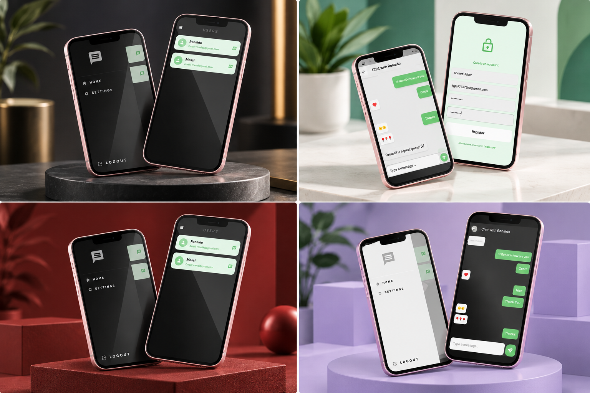

<div align="center">

# 💬 Real-Time Chat App

### Flutter • Firebase • Cloud Firestore • BLoC • MVVM

A modern real-time messaging application built with
**Flutter and Firebase**, featuring instant messaging,
user authentication, user discovery, and a clean,
responsive chat interface.


</div>

---

## 📸 Project Preview

<div align="center">

<a href="32b50a37-18b9-47a7-9042-1d9c2af377c3.png">
  
</a>

</div>

---

## 📖 About the Project

**Real-Time Chat App** is a Flutter-based
messaging application designed to enable
instant communication between users.

The application integrates Firebase
Authentication and Cloud Firestore to
support user accounts and real-time
message synchronization.

It uses BLoC for state management and
MVVM principles to organize application
logic and user interface components.

The project demonstrates practical
experience building reactive,
backend-driven mobile applications.

---

## ✨ Key Features

### 🔐 User Authentication

- User registration and login.
- Firebase Authentication integration.
- User session management.
- Secure authentication workflows.

### 💬 Real-Time Messaging

- Send and receive messages.
- Real-time Firestore updates.
- Conversation-based chat interface.
- Automatically updated message lists.
- Instant message synchronization.

### 👥 User Discovery

- Browse available users.
- Discover other accounts.
- Select users to start conversations.
- User information display.

### 📱 Chat Interface

- Modern messaging interface.
- Sent and received message bubbles.
- Organized conversation layout.
- Responsive Flutter widgets.
- Easy-to-use message input.

### 🎨 Themes & UI

- Custom application themes.
- Clean and intuitive navigation.
- Consistent UI components.
- Modern Material Design styling.

### 🧠 State Management

- BLoC state management.
- Reactive UI updates.
- Separation of presentation and logic.
- Structured application states.

---

## 🛠️ Technologies Used

| Technology | Purpose |
|------------|---------|
| Flutter | Cross-platform UI |
| Dart | Application logic |
| Firebase Authentication | User authentication |
| Cloud Firestore | Real-time messaging database |
| Firebase | Backend services |
| BLoC | State management |
| MVVM | Application architecture |
| Git & GitHub | Version control |

---

## 🏗️ Application Architecture

The application uses an MVVM-inspired
structure with BLoC for reactive
state management.

```text
          Real-Time Chat App
                  |
                  v
            Flutter UI
                  |
                  v
           BLoC / States
                  |
                  v
          Application Logic
                  |
                  v
          Firebase Services
                  |
          +-------+-------+
          |               |
          v               v
   Authentication     Cloud Firestore
                          |
                          v
                    Conversations
                          |
                          v
                       Messages
```

---

## 🔄 Real-Time Messaging Flow

```text
           User A
              |
              v
       Write a Message
              |
              v
        Send Message
              |
              v
       Cloud Firestore
              |
              v
      Real-Time Listener
              |
              v
           User B
              |
              v
       Message Displayed
```

### How It Works

1. A user signs in through Firebase Authentication.
2. The user selects another account to start a conversation.
3. Messages are stored in Cloud Firestore.
4. Firestore listeners receive database changes.
5. The application updates the conversation UI.

---

## 📱 Application Modules

| Module | Description |
|--------|-------------|
| Authentication | User login and registration |
| User Discovery | Browse and find users |
| Conversations | Display chat conversations |
| Messaging | Send and receive messages |
| Firestore | Real-time data synchronization |
| Themes | Application appearance |
| State Management | BLoC-based UI updates |

---

## 🚀 Getting Started

### Prerequisites

Make sure you have installed:

- Flutter SDK
- Dart SDK
- Android Studio or VS Code
- Git
- Firebase project
- FlutterFire CLI, if required by your setup

### 1. Clone the Repository

```bash
git clone <YOUR_CHAT_APP_REPOSITORY_URL>
```

Replace the placeholder with your
actual GitHub repository URL.

### 2. Navigate to the Project

```bash
cd <YOUR_PROJECT_FOLDER>
```

### 3. Install Dependencies

```bash
flutter pub get
```

### 4. Configure Firebase

Create a Firebase project at:

https://console.firebase.google.com/

Configure the required Firebase services:

- Firebase Authentication.
- Cloud Firestore.
- Supported platform configuration.
- Appropriate Firestore Security Rules.

If the project uses FlutterFire CLI,
configure the Firebase project using:

```bash
dart pub global activate flutterfire_cli
flutterfire configure
```

Ensure the Firebase configuration matches
the initialization code in your project.

### 5. Configure Authentication

Enable the authentication providers
used by your application in the
Firebase Console.

For example, enable Email/Password
if the project uses that login method.

### 6. Configure Firestore

Create the Firestore database and
configure appropriate security rules.

The database structure must match
your application's data models.

For production applications, restrict
access so users can only read and
write data they are authorized to access.

### 7. Run the Application

```bash
flutter run
```

---

## 🔒 Security Considerations

- Use Firebase Authentication for user identity.
- Protect conversations with Firestore Security Rules.
- Validate message access permissions.
- Prevent unauthorized database modifications.
- Avoid publishing sensitive user information.
- Do not use unrestricted Firestore rules in production.

---

## 💡 Development Highlights

This project demonstrates experience in:

- Flutter application development.
- Firebase Authentication integration.
- Cloud Firestore real-time listeners.
- Building messaging interfaces.
- Reactive state management with BLoC.
- MVVM application organization.
- Handling asynchronous database updates.
- Developing responsive mobile interfaces.

---

## 🎯 Project Goals

- Build a real-time messaging application.
- Enable communication between users.
- Integrate Flutter with Firebase.
- Implement reactive messaging interfaces.
- Practice BLoC state management.
- Organize application logic using MVVM principles.

---

## 🔮 Potential Future Improvements

- Push notifications.
- Image and file sharing.
- Voice messages.
- Group conversations.
- Message reactions.
- Read receipts.
- Online/offline indicators.
- Message search.
- End-to-end encryption.

---

## 👨‍💻 Developer

**Ahmed Jaber Ahmed**

Flutter Developer | Mobile App Developer

B.Sc. Computer Science & Artificial Intelligence

📍 Cairo, Egypt

- [GitHub](https://github.com/AhmedJaberAhmed)
- [Portfolio](https://ahmedjaberahmed.github.io/Jaber-website/)
- [LinkedIn](https://www.linkedin.com/in/ahmedjaberahmed/)

---

<div align="center">

### ⭐ Support the Project

If you find this project interesting,
consider giving it a star!

**Built with Flutter 💙 and Firebase 🔥**

</div>
